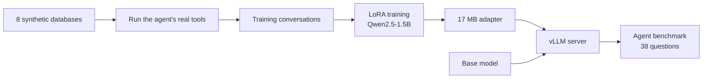

# Fine-Tuning a Small LLM for Agent Tool Calling

This project fine-tunes Qwen2.5-1.5B with LoRA to drive the [Agentic AI Data Analyst](https://github.com/ykrubha/agentic-data-analyst), serves it with vLLM, and scores it on that agent's 38-question benchmark.

**Result: fine-tuning took the model from 0 of 38 to 17 of 38 correct, and cut tool errors from 77 to 14.** It trained just 0.28% of the model's parameters, in about 35 minutes on a free Colab T4 GPU. It's still well behind a larger hosted model, which scored 37 of 38.

## Results

| Metric | Qwen 1.5B base | Qwen 1.5B + LoRA | Gemini 3.5 Flash Lite |
|---|---:|---:|---:|
| **Correct** | **0/38** | **17/38** | **37/38** |
| Aggregation | 0/8 | 6/8 | 8/8 |
| Joins | 0/10 | 3/10 | 10/10 |
| Multi-step | 0/8 | 2/8 | 8/8 |
| Python analysis | 0/6 | 3/6 | 5/6 |
| Refusals | 0/6 | 3/6 | 6/6 |
| Finished with an answer | 28/38 | 36/38 | 37/38 |
| Tool errors | 77 | 14 | 20 |
| Mean steps | 4.05 | 4.79 | 6.5 |

The base and LoRA models ran on one vLLM server with temperature 0. The Gemini score comes from an [earlier run](https://github.com/ykrubha/agentic-data-analyst) with the same agent code and benchmark, through a free-tier API. Its speed isn't comparable because of pacing and retries, so latency isn't compared here.

### What changed

The traces in [`results/`](results/) show what the model learned:

- **Before:** it guessed table names such as `customers` instead of reading the schema, used wrong tool arguments such as `sql` instead of `query`, and invented answers after errors, such as total revenue of "$0" after a failed query.
- **After:** it lists tables, reads the relevant schemas, writes queries with valid arguments, and fills in `final_answer` in the right format. It also refused all 2 write requests and 1 of 4 questions about missing data.

### What it didn't fix

- **It learned recipes, not analysis.** Its SQL closely copies the training templates, down to aliases like `label` and `metric` and `LIMIT 2`. It does well when a question fits a pattern, and it does poorly when one doesn't, as with percentages of a total or gaps between dates.
- **One pass was lucky.** `join03` got the correct genre by summing track list prices rather than actual sales, so 16 of the 17 passes used valid logic.
- **It can still answer confidently and wrongly.** Examples are counting all tracks when asked about one artist, and inventing an answer about customer age instead of noticing the column doesn't exist.

### How to read the score

- **The benchmark is hand-written and small.** With 38 questions, each one moves the score by about 2.6 points. This is one run of each model.
- **Training and benchmark questions are similar in kind.** No training question exactly matches a benchmark question, and the databases are different, but the types of question overlap because that's the skill being trained. The score shows the model learned this agent's workflow, and it may do worse on unfamiliar kinds of questions.
- **Validation loss isn't accuracy.** It fell to 0.0053 on unseen database domains, but the training data comes from templates, so low loss mostly shows the model predicts the format well. The benchmark is the meaningful measure.
- **Serving ran on one GPU in Colab.** This isn't a production load test.

## How it works



- **Training data:** the agent's real tools run on 8 synthetic databases, such as hospital and logistics, producing 505 training and 62 validation conversations. Every tool result is real, and the data includes error recovery and refusals.
- **No benchmark leakage:** the databases don't use the benchmark's schema or data, and a test rejects any question that exactly matches the benchmark. That test caught one real overlap during development.
- **Held-out schemas:** two database domains are used only for validation.
- **Labels:** only the assistant's turns count toward the loss, and a check stops training if the chat template would misplace those labels.
- **Training:** a small PyTorch loop with LoRA (rank 16) on the attention layers, 3 epochs, keeping the adapter with the lowest validation loss. It resumes after a disconnect.
- **Serving:** vLLM serves the base model and adapter from one server, with hermes tool-call parsing.

## Run it

Open [`notebooks/finetune_colab.ipynb`](notebooks/finetune_colab.ipynb) in Google Colab with a T4 GPU, then run the cells in order. vLLM isn't pinned to a version, so a future release might need small changes. The trained adapter is in [`models/lora-adapter`](models/lora-adapter).

To run the tests without a GPU, using a tiny random model:

```bash
python -m venv .venv && source .venv/bin/activate
git clone https://github.com/ykrubha/agentic-data-analyst.git agent
pip install -e agent -e ".[dev,train]" jinja2
pytest -q
```

## Project layout

```
src/finetune/
  databases.py    synthetic training databases
  traces.py       runs the real tools to create conversations
  train.py        labels, LoRA setup, training loop
scripts/          generate data, train, compare results
notebooks/        the full Colab workflow
models/           trained LoRA adapter
results/          per-question results and traces for each model
tests/            data checks, leakage checks, training on a tiny model
```

## License

MIT for this code. The adapter derives from Qwen2.5-1.5B-Instruct, so check that model's license on Hugging Face before reusing it.
